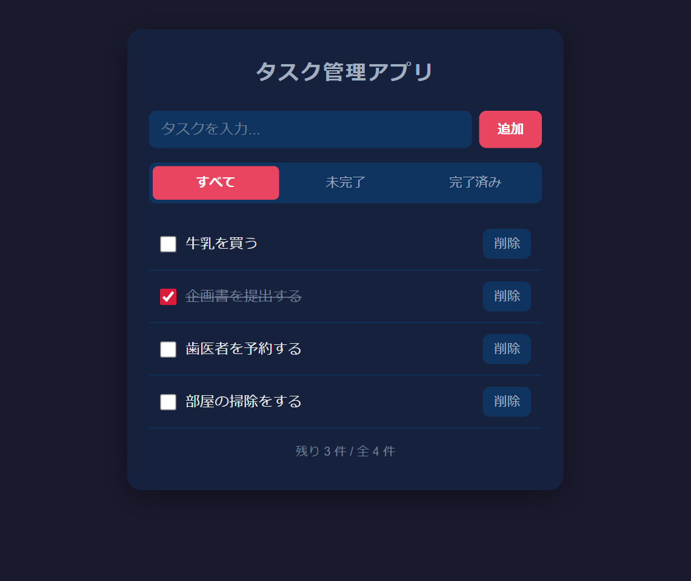

# ポートフォリオ

## 概要
Vanilla JavaScript で実装したタスク管理アプリ（ToDo アプリ）です。  
ZennのWEB書籍を執筆するために制作しました。  
アプリ名：TaskApp  
WEB書籍：[JavaScript入門 - タスク管理アプリを作ってみよう!](https://zenn.dev/eguchi244_dev/books/js-task-tutorial-eguchi244)



## 制作経緯
本アプリとWEB書籍は、フレームワークを使う前の JavaScript で、データの追加・表示・更新・削除（CRUD）を学ぶチュートリアル教材として活用したいという気持ちから制作しました。

制作にあたっては下記の項目を

* フレームワーク・外部ライブラリを使わず、ブラウザだけで動かす
* 配列を唯一のデータ置き場にし、「状態を変えてから、状態をもとに画面を描き直す」設計を一貫させる
* イベントデリゲーションで、増減する要素のクリックを親要素でまとめて受け取る
* ユーザーの入力を `textContent` で表示し、XSS を防ぐ
* `localStorage` に保存し、壊れたデータでも起動できるようにする

満たす体験を実現するようにしました。

## 要件&仕様
本アプリは下記の

* タスク名を入力し、追加ボタンまたは Enter キーでタスクを追加できる（空のタスク名は追加しない）
* チェックボックスで完了/未完了を切り替え、完了したタスクには打ち消し線が付く
* 削除ボタンでタスクを削除できる
* 「すべて / 未完了 / 完了済み」のタブで一覧を絞り込める
* 残りのタスク件数と総件数を表示する
* タスクは localStorage に保存され、リロードしても残る

を要件とする簡易なアプリです。

## システム構成
【技術スタック】
* HTML5, CSS3
* JavaScript（ES6+）
* localStorage
* 外部ライブラリ・ビルドツール不使用

【ディレクトリ構成】
```
JS-Task-Tutorial-PJ（ルートディレクトリ）
├── index.html   # フォーム・フィルタータブ・タスク一覧・フッター
├── style.css    # スタイル
├── script.js    # タスクの操作・画面の描画・localStorage への保存
├── img          # README の画面
└── README.md
```

## WEB書籍の章とブランチ
WEB書籍の各章の末尾にある「ここまでのソースコード」は、下記のブランチを指しています。答え合わせにご活用ください。

| 章 | ブランチ | 内容 |
|---|---|---|
| [入門03 - タスクの追加と一覧描画](https://zenn.dev/eguchi244_dev/books/js-task-tutorial-eguchi244/viewer/js-task-add) | `Chapter03/タスクの追加と一覧描画` | 入門03を終えた時点のコード |
| [入門04 - 完了切り替えと削除](https://zenn.dev/eguchi244_dev/books/js-task-tutorial-eguchi244/viewer/js-task-toggle-delete) | `Chapter04/完了切り替えと削除` | 入門04を終えた時点のコード |
| [入門05 - フィルタリングと件数表示](https://zenn.dev/eguchi244_dev/books/js-task-tutorial-eguchi244/viewer/js-task-filter) | `Chapter05/フィルタリングと件数表示` | 入門05を終えた時点のコード |
| [入門06 - localStorageで永続化する](https://zenn.dev/eguchi244_dev/books/js-task-tutorial-eguchi244/viewer/js-task-storage) | `Chapter06/localStorageで永続化する` | 入門06を終えた時点のコード（完成版と同じ） |
| ― | `main` | 完成版 |

## 前提条件
PCに下記がインストールされていること。

* モダンブラウザ（Google Chrome 最新版を基準に動作確認）
* Git（ZIP でダウンロードする場合は不要）
* VS Code + Live Server 拡張機能（任意。保存するたびにブラウザが自動でリロードされる）

## 環境構築
Github から TaskApp をローカル環境に構築する手順です。  
任意の作業フォルダ内で下記を実施してください。

1. GitHubよりプロジェクトをダウンロードする
```
$ git clone https://github.com/eguchi244/JS-Task-Tutorial-PJ.git
$ cd JS-Task-Tutorial-PJ
```
2. 章の途中のコードを見たい場合は、ブランチを切り替える（任意）
```
$ git switch Chapter03/タスクの追加と一覧描画
```

## 動作確認
1. index.html をブラウザで開く  
VS Code の場合は `index.html` を右クリック →「Open with Live Server」で起動します。ダブルクリックでブラウザに直接開いても動作します。
2. タスクを追加・完了・削除する  
入力欄にタスク名を入れて追加ボタン（または Enter）を押すと一覧に追加されます。チェックボックスで完了にすると打ち消し線が付き、削除ボタンで消えます。
3. 絞り込みと保存を確認する  
「未完了」「完了済み」タブで一覧が絞り込まれます。ページをリロードしても、タスクと完了の状態が残っています。
